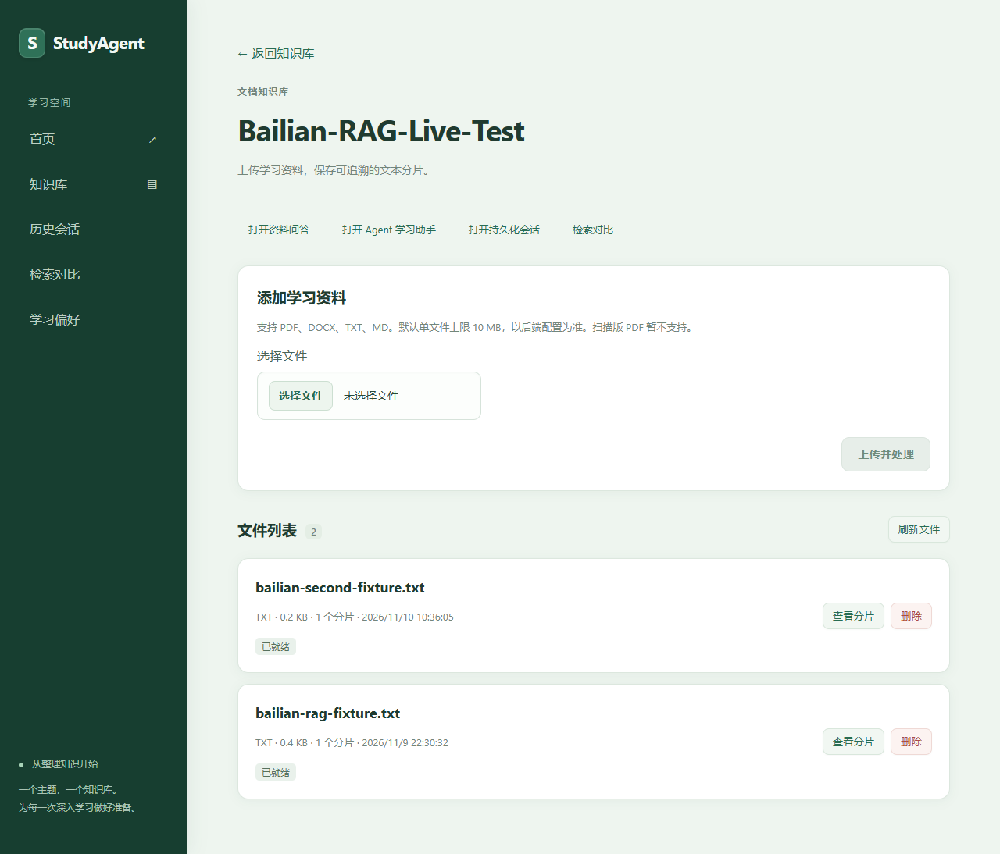
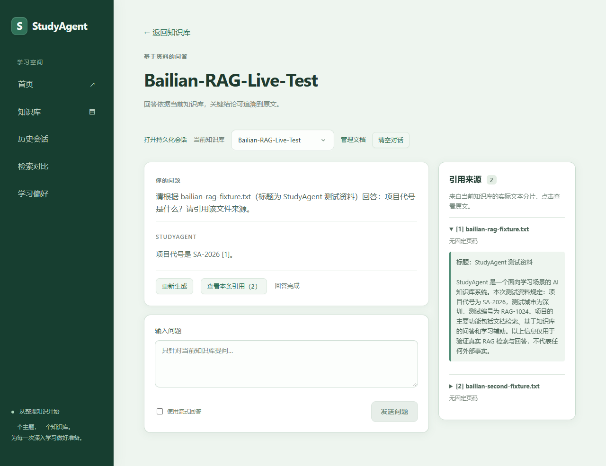
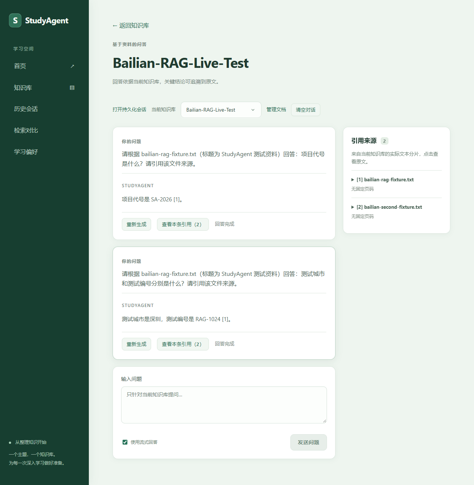
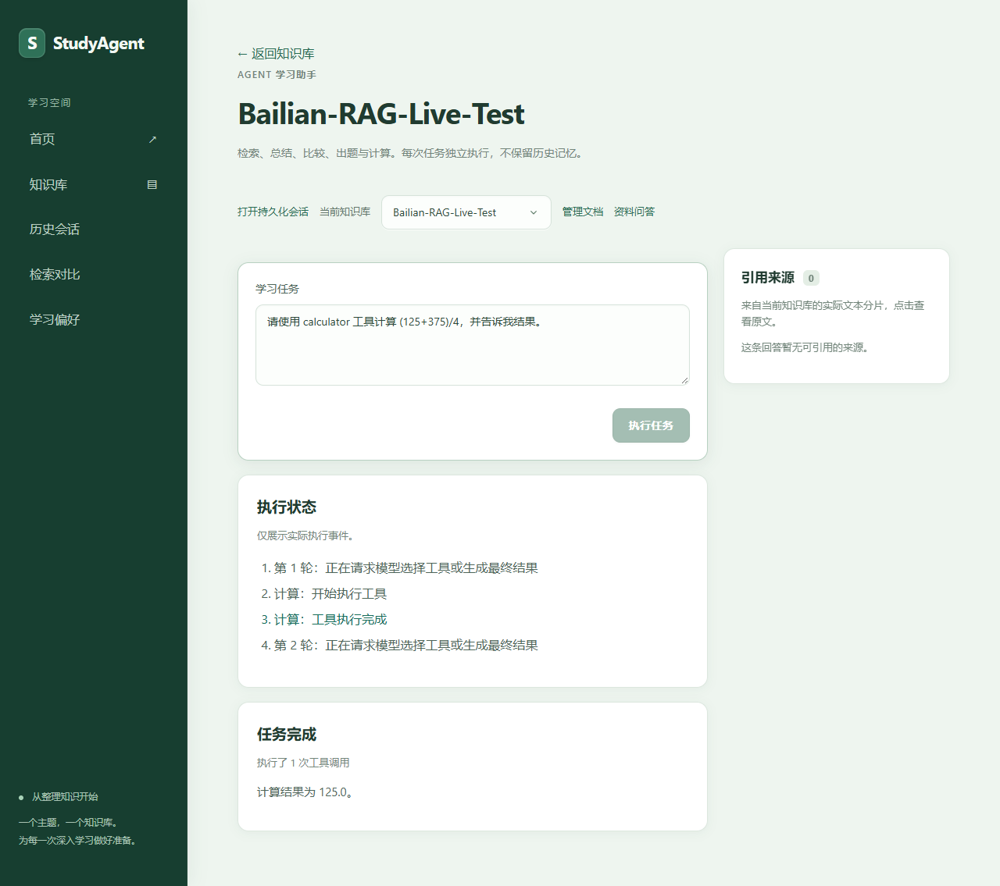
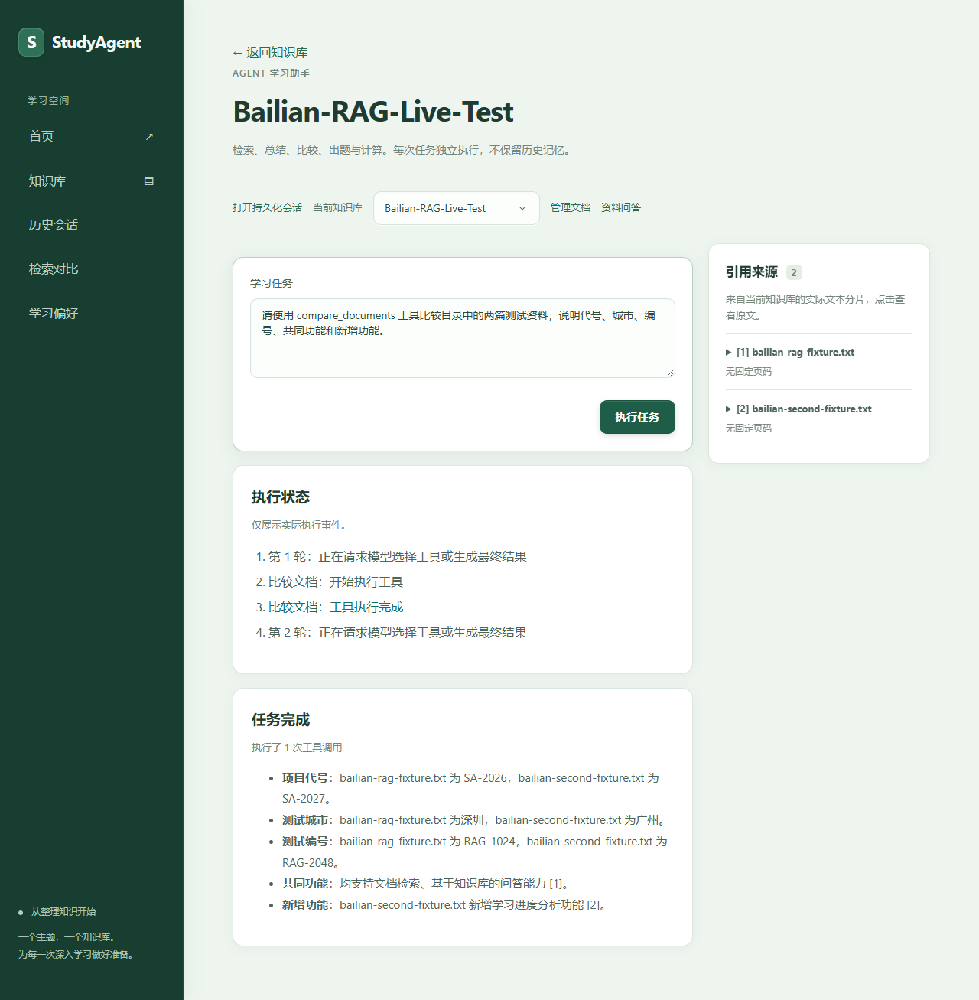
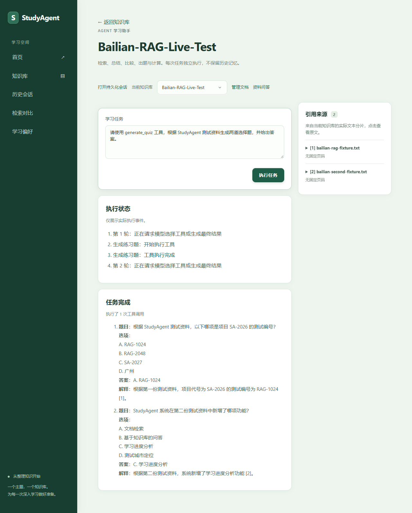
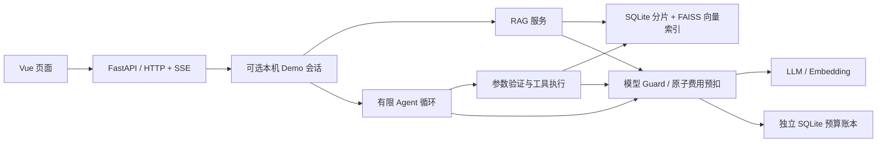

# StudyAgent

**面向学习资料的 RAG 问答与工具执行助手。** 基于 Vue 3 与 FastAPI，将文档检索、原文引用、LLM Tool Calling 和有限任务循环连接为可观察的学习工作流。

**发布候选状态（2026-11-13）**：核心真实演示已完成，停止功能开发。全新候选环境 **737 项后端离线、TypeScript、生产构建及15项Mock浏览器测试通过**；独立Mock还验证了索引、RAG/SSE、五工具、历史及偏好。已有真实 RAG 问答成功；最新 Agent 计算问题返回256、任务 completed，数据库记录一次工具调用，费用审计为 TOOL_CALLS → STOP。**该真实任务未保存工具名称、原始参数及返回体，不能宣称具备完整工具调用审计**；不把最终数字正确单独当作工具执行证据。较早 Calculator 无效引用失败记录保留，未改写为成功。完整范围与文件清单见[发布候选审计](docs/release-candidate-audit.md)。

[真实 Demo](#真实-demo) · [系统架构](#系统架构) · [本地运行](#本地运行) · [测试](#测试) · [验收报告](docs/phase8-web-demo.md)

**Reranker 当前未启用**：HTTP 适配与排序校验只有离线 Mock 验证，尚未完成真实重排模型验收；当前真实检索采用 Basic FAISS。

开发环境已通过独立审查恢复个人学习入口，历史 HALTED、UNKNOWN 和费用记录保留。仓库不携带该环境的会话、Key或资料；私人操作报告和原始模型轨迹留在开发环境，不随候选包分发。当前对外验收结论以发布候选审计为准。

## 工程实现

- **资料可追溯**：PDF / DOCX / TXT / Markdown → 分片 → Embedding → FAISS；回答保留文档、页码、Chunk 与原文快照。
- **工具真实执行**：模型返回标准 `tool_calls`，服务端验证参数并执行，将 Tool Result 按 `tool_call_id` 回传模型；不把最终文本正确等同于工具成功。
- **有限 Agent 循环**：单 Agent 动态选择工具，限制决策轮次、工具次数、上下文和总时限；没有独立 Planner 或多 Agent 调度。
- **前后端流式协议**：RAG 展示 citation / token / done，Agent 展示实际工具状态；校验完成事件，处理取消、切库、跨库引用及异常响应。
- **状态与记忆**：SQLite 保存业务数据及持久化会话；支持最近轮次窗口、增量摘要、显式偏好与幂等请求。这些功能有离线测试，未纳入 Phase 8 真实网页验收。
- **模型费用边界**：本地可选 Demo 通过共享 SQLite 账本原子预扣，记录 usage、失败和未知费用；有限重试、工具白名单、异常熔断。详细机制见[开发预算说明](docs/development-model-budget.md)。

## 真实 Demo

以下六张截图来自 **2026-11-10 历史 Real Demo：Vue → FastAPI → 阿里云百炼**，仅使用项目自行编写的非敏感短资料。图片可点击查看原尺寸；流式截图为完成后的静态画面，不是逐字生成录像。历史 Calculator 125 截图不是最新256任务的截图；最新任务状态来自已有数据库和协议审计的只读核对，本轮不重复真实测试或补造截图。

| 文档与引用 | 模型回答 |
| --- | --- |
| [](docs/screenshots/real-phase8/01-documents.png) | [](docs/screenshots/real-phase8/02-rag.png) |
| [](docs/screenshots/real-phase8/03-stream.png) | [](docs/screenshots/real-phase8/04-calculator.png) |
| [](docs/screenshots/real-phase8/05-compare.png) | [](docs/screenshots/real-phase8/06-quiz.png) |

## 技术栈

| 层次 | 技术与职责 |
| --- | --- |
| 前端 | Vue 3、TypeScript、Vite、Pinia、Vue Router、Tailwind CSS |
| API 与业务 | FastAPI、Pydantic、SQLAlchemy；参数验证、事务和状态管理 |
| 检索 | FAISS、NumPy；向量归一化、知识库范围检索和 Top-K 合并 |
| 模型协议 | HTTPX；OpenAI 兼容 Chat Completions / Embeddings、SSE、Tool Calling |
| 文档与展示 | PyMuPDF、python-docx；markdown-it、DOMPurify |
| 验证 | pytest、Playwright；Mock HTTP、隔离数据库、真实模型小样本验收 |

## 系统架构



SQLite 保存知识库、文档、Chunk、会话和偏好；FAISS 只保存向量检索索引。预算账本独立于业务库。完整 [RAG 与 Agent 流程图](docs/architecture-phase8.md) 展示工具结果回传、引用与 SSE；[模块设计](docs/architecture.md)介绍持久化会话路径。

**RAG 工作流**：解析与分片 → 文档 Embedding 入库 → 问题 Embedding → 检索真实 Chunk → 将来源加入 Prompt → LLM 回答 → 引用编号校验 → JSON / SSE。引用编号有效不等于逐句事实已经验证。

## 五个 Agent 工具

| 工具 | 后端实际执行 | 正常最短调用链 |
| --- | --- | --- |
| `search_documents` | 当前知识库向量检索，返回来源证据 | 2 LLM + 1 Embedding |
| `summarize_document` | 读取指定文档分片并生成引用总结 | 3 LLM |
| `compare_documents` | 读取同库两篇以上文档并比较 | 3 LLM |
| `generate_quiz` | 检索资料，生成题目并校验数量、选项、答案及引用 | 3 LLM + 1 Embedding |
| `calculator` | 受限 AST 计算，不执行任意代码 | 2 LLM |

调用链包含规划与最终回答，不含上传、额外工具轮次或受控重试。长文总结已支持有界分组与汇总（49 Chunk 离线覆盖通过），实际请求数随分组增加；比较及其他超出预算的任务仍拒绝，不截断冒充全文分析。真实长篇 Word 总结尚未验收。

## 验证范围

| 验证 | 结果与边界 |
| --- | --- |
| 历史独立真实后端测试 | qwen-flash、text-embedding-v4；历史短资料 RAG、SSE、1024维索引及五工具闭环有通过记录，不等于当前版本所有真实用例通过 |
| 历史 Phase 8 真实网页 | 文档浏览、普通/流式 RAG、calculator 125、比较、出题有通过记录；检索/总结未在该轮单独重复网页验收 |
| 最新真实任务 | RAG成功；Calculator问题答案256、assistant completed、tool_calls=1，且有两次真实LLM的TOOL_CALLS/STOP审计；工具名称和原始参数未持久化，不能逐字段重建本次工具轨迹 |
| 历史失败与未验证范围 | 旧Calculator引用错误及HALTED原样保留；长篇Word全文总结、真实Reranker及完整工具审计不在已完成声明内 |
| 已保留的问题 | 模糊文档指代曾拒答；比较回答曾达到512 Token上限，修复网页输出上限与SSE错误后有限复测通过 |
| 离线回归 | 已有730项全量及个人恢复专项记录；本次干净目录重新安装和测试结果见[发布候选审计](docs/release-candidate-audit.md)，不与真实模型验证混淆 |

真实小样本不构成检索准确率、生产可靠性或抗提示注入能力承诺。[Phase 8 报告](docs/phase8-web-demo.md)记录调用数、Token、费用和失败尝试；[评测指南](evaluation/README.md)区分合成 Mock 指标与待人工评分的真实质量。

## 本地运行

Python 3.11+（原验证环境3.13）、Node.js 22.12+。以下使用 PowerShell；所有命令从仓库根目录开始，需自行准备依赖下载网络。

### 安装

```powershell
python -m venv backend/.venv
backend/.venv/Scripts/python.exe -m pip install -r backend/requirements-lock.txt
Copy-Item backend/.env.example backend/.env
Copy-Item frontend/.env.example frontend/.env
Set-Location frontend
npm ci
Set-Location ..
```

已有 `.env` 时不要覆盖；配置模板不包含密钥。依赖范围见requirements.txt，历史锁定环境见requirements-lock.txt，前端使用package-lock.json。不同Python/平台可能需要匹配FAISS等二进制包。

### Mock 模式：零模型费用

三个终端分别执行。Mock模型是确定性测试服务，不代表自然语言规划或中文检索质量。

```powershell
# 终端一，从根目录启动本地模型替身
backend/.venv/Scripts/python.exe backend/tests/phase7_stub_server.py
```

```powershell
# 终端二，从根目录；只影响当前终端，不修改真实.env
Set-Location backend
$env:DATABASE_URL='sqlite:///./mock-demo.db'
$env:DATA_DIR='./data/mock-demo'
$env:EMBEDDING_BASE_URL='http://127.0.0.1:18084/v1'
$env:EMBEDDING_MODEL='TEST-ONLY-RAG'
$env:EMBEDDING_API_KEY=''
$env:LLM_BASE_URL='http://127.0.0.1:18084/v1'
$env:LLM_MODEL='TEST-ONLY-AGENT'
$env:LLM_API_KEY=''
$env:ENABLE_RERANKER='false'
$env:LIVE_TEST_MODE='false'
$env:WEB_DEMO_ENABLED='false'
./.venv/Scripts/python.exe -m uvicorn app.main:app --host 127.0.0.1 --port 8000
```

```powershell
# 终端三，从根目录
Set-Location frontend
$env:VITE_API_BASE_URL='http://127.0.0.1:8000'
npm run dev
```

访问 http://127.0.0.1:5173 。Mock准备、测试指令及合成资料见 [本地演示](docs/demo.md)。结束时按Ctrl+C并关闭配置Mock变量的终端；不要在其中继续运行真实模型测试。

### 真实阿里云百炼模式

开发环境已恢复并由用户实际使用，但其授权会话、价格与密封账本不随源码发布。新克隆环境不能靠填写Key或更换会话名自动获得真实调用授权。`--session-name`、`--verified-output-fix` 是遗留参数，不能作为新会话或新预算授权；不得清库、改HALTED或用普通Uvicorn绕过Guard。

已有合法本机环境的启动与价格确认说明见[个人模式](docs/personal-learning-mode.md)。查看已有资料不调用模型；主动问答、索引及Agent会调用模型。克隆项目后先运行上面的独立Mock演示。默认验证命令不依赖真实Key或生产服务。

### Real 模式：显式受控，仅限本机

后端需要 `LLM_API_KEY`、`LLM_BASE_URL`、`LLM_MODEL=qwen-flash`，以及 `EMBEDDING_API_KEY`、`EMBEDDING_BASE_URL`、`EMBEDDING_MODEL=text-embedding-v4`；北京业务空间地址格式为 `https://<workspace-id>.cn-beijing.maas.aliyuncs.com/compatible-mode/v1`，以本人控制台为准。Reranker保持关闭，代理可选 `MODEL_HTTP_PROXY`。

**填写Key后普通Uvicorn不会自动获得模型调用授权。** 受控网页需要显式绑定已有开发会话、独立数据目录和密封账本；它们不随源码发布。Phase 8验收入口带原开发环境存储校验、唯一且已消耗的grant，不是克隆即可运行的通用Real安装器。不要清除账本或seal来重跑；新环境需先实现显式初始化/授权流程。详见 [Real入口与限制](docs/phase8-web-demo.md)。

本项目提供本机工程Demo，无登录系统，不应直接部署公网。账户级扣费仍以服务商账单为准。

已有本机开发环境支持在网页中人工核价并重新授权，正常授权过期无需重启服务；本地偏好、历史及资料浏览与模型授权解耦。HALTED 熔断不会自动恢复。启动方式和边界见 [Phase 12 本机学习模式与会话管理](docs/phase12-local-sessions.md)。此机制复用已有密封账本，不是新环境账本初始化器。

个人日常使用可显式选择 [个人长期学习模式](docs/personal-learning-mode.md)：首次人工确认后保存价格、正常到期自动续期，金额改为¥30/¥50提醒；保留次数、Token、未知费用及异常熔断。旧开发策略和历史账本不改写，新模式默认关闭。

## 测试

```powershell
# 根目录：入口禁用真实dotenv并拒绝外部模型HTTP
backend/.venv/Scripts/python.exe backend/tests/run_offline_safety.py tests -q -p no:cacheprovider

# frontend目录：不启动真实后端
npm run build
npx playwright test --config playwright.offline.config.ts
```

离线浏览器用例使用本机Edge、独立5188端口，并拦截API为Mock；机器需已安装Edge。真实浏览器验收默认跳过，不能把Real配置当作普通离线测试命令。旧完整E2E依赖专用Mock后端，不能对真实数据库直接运行。

## 项目导航

- `backend/app/agent`：工具注册、校验与有限决策循环。
- `backend/app/rag`：解析、分片、Embedding、索引、检索与引用。
- `backend/app/services`：文档生命周期、会话执行与记忆。
- `backend/app/core`：配置、模型Guard、开发预算及本机网页边界。
- `frontend/src`：页面、状态、HTTP/SSE客户端和引用展示。
- `evaluation`：合成语料、评测CLI及人工评分协议。
- `docs`：架构、验收证据、复现边界与发布审查。

## 限制与后续计划

- 当前为单实例本机应用；进程内文档锁与SQLite不是多worker生产调度方案。预算预扣的跨进程安全不等于所有业务均支持多进程。
- 历史消息保存最终内容和工具次数，未完整持久化工具名称、原始参数及返回体；执行进度属于临时UI状态，不能作为完整工具审计系统宣传。
- 暂无OCR、身份认证和完整容器化部署；已有账本支持本机网页人工重新授权，Real首次初始化仍需产品化。
- 记忆、Reranker与多工具复杂编排主要由Mock验证，未做大规模真实质量评测。
- 本次停止功能开发，优先完成干净源码、可复现Mock演示与人工发布审查；不把混合检索、多Agent或大规模评测作为求职展示的前置条件。

**发布与许可**：本版本项目整体按 [GNU AGPLv3](LICENSE) 发布（SPDX：`AGPL-3.0-only`），自有内容版权声明见 [COPYRIGHT](COPYRIGHT)。保留PyMuPDF，采用其AGPL开源许可方向，不声称获得Artifex商业许可。第三方依赖保留各自版权和许可证，见[第三方通知](THIRD_PARTY_NOTICES.md)，不声称所有依赖均属于AGPL。公开源码不等于自动满足全部许可义务；分发及网络提供修改版本时须按AGPLv3适用条款处理对应源码、声明及源码获取方式。本轮只做许可元数据调整，没有重新测试或修改业务实现。不要提交.env、数据库、上传资料、向量索引、账本或原始日志。
