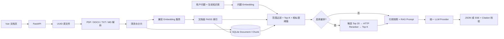
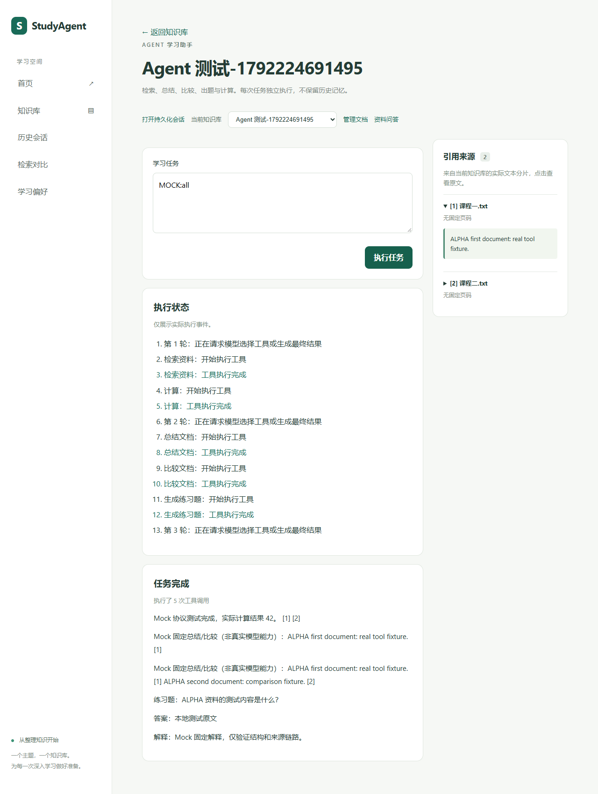
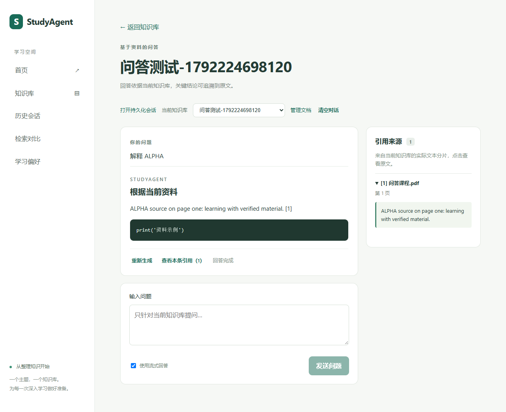

# StudyAgent · RAG 与 Agent 学习资料助手

Vue 3 + TypeScript + FastAPI 学习资料助手。保留 Phase 1–6 功能及接口兼容性；提供默认关闭的可选 Reranker、检索对比页面、可复现的 RAG 评测与本地 Demo。

## 技术栈

- 前端：Vue 3、TypeScript、Vite，Markdown 展示与 SSE 流式交互。
- 后端：Python、FastAPI、Pydantic、SQLAlchemy、SQLite。
- RAG / Agent：FAISS、文档解析、兼容 HTTP 的 LLM / Embedding Provider、Tool Calling、有界会话记忆与可选 Reranker。
- 验证：pytest、Playwright（Chrome）、公开合成语料及评测脚本。

**当前演示和已完成验证使用 Mock LLM / Embedding / Reranker；尚未完成真实模型效果验证。应用本身不会自动回退到 Mock，演示必须启动测试服务并配置地址。**

## 本轮验证

2026-10-17 Phase 7：完整 pytest **409 passed、0 failed、0 skipped**（新增 49 项），TypeScript/Vite 构建通过，完整 Chrome E2E **17 passed、0 failed、0 skipped**（新增 2 项）。详见 [Phase 7 测试与交付报告](docs/phase7-testing.md)。原有测试未删除或降低断言。历史报告：[Phase 6（360 / 15）](docs/phase6-testing.md)、[Phase 5（301 / 10）](docs/phase5-testing.md)。

[本地 Demo 与运行步骤](docs/demo.md) · [架构设计](docs/architecture.md) · [评测说明](evaluation/README.md) · [GitHub 展示材料](docs/github-showcase.md)

仅使用本机 Mock LLM / Embedding 和测试内 MockTransport；实际执行 API、SQLite、FAISS、文档工具、引用校验和浏览器交互。未配置真实 API，Mock 回答不能代表真实模型能力。

## Phase 7：可选重排与检索对比

默认 `ENABLE_RERANKER=false`，既有 Basic RAG 行为不变。启用后，在当前知识库的 ready 文档中按原相似度阈值召回全局最多 20 个候选，经 HTTP 重排后选 Top-K（默认 5）送入 LLM。Chat、Agent 检索工具及持久化会话共用该 Retriever；来源原文、页码、chunk_id 和向量相似度保持不变。

侧栏“检索对比”分别执行 Basic RAG 与 RAG + Reranker，显示耗时、排序和可展开来源；不调用 LLM、不保存会话，也不改变全局开关。对比模式会显式请求重排，服务未配置时显示该分支错误，Basic 结果仍可查看。启用重排的正式问答遇到超时、限流或无效排序会明确失败，不静默退回 Basic。

| 配置 | 默认值 / 说明 |
| --- | --- |
| ENABLE_RERANKER | false |
| RERANKER_BASE_URL / RERANKER_MODEL | 空；仅使用时配置 |
| RERANKER_API_KEY | 空；密钥仅在后端 |
| RERANKER_CANDIDATE_K | 20，范围 20–100 |
| RERANKER_TIMEOUT_SECONDS | 15 秒 |
| RERANKER_MAX_INPUT_CHARS | 100000，问题与候选原文总字符预算 |

协议为 `POST {RERANKER_BASE_URL}/rerank`，传入 model、query、documents、top_n（全部候选数），要求 results 返回每个候选的 index 和有限数值 relevance_score。完整校验、错误码见 [API 文档](docs/api.md)。这是明确的适配协议，尚未验证任何真实供应商。

评测使用项目原创的 6 篇公开合成笔记及 6 个问答，记录 Retrieval Hit Rate、响应时间和人工 0/1/2 答案评分。未评分时 Answer Accuracy 为 null，并显示评分覆盖量。本次仅运行本地 Mock，示例结果见 [原始 Mock 评测记录](docs/phase7-mock-results.json)；不能据此声称真实检索提升、答案准确率或模型性能。


## Phase 5 使用方式

1. 打开侧栏“历史会话”，选择已有知识库与 chat/agent 模式并创建会话。原 Chat/Agent 页面也提供“打开持久化会话”入口。
2. 在会话详情连续提问。用户输入、结果、引用快照和执行状态自动写入数据库，刷新或重启后可继续。Chat 支持普通及流式返回，Agent 展示真实工具执行事件。
3. 可重新生成最后一轮，各次尝试完整保留；历史列表支持知识库/模式筛选、分页、重命名和删除。
4. “学习偏好”支持回答风格、学习目标、回答语言，逐项恢复默认。只接受显式枚举设置，不自动从资料或聊天提取偏好。

原有临时 Chat/Agent 入口保留 Phase 3–4 行为；这些不带 conversation_id 的请求不自动落库、不注入记忆。需要保存时使用持久化会话入口。

## 记忆、摘要与持久化约束

- 每个会话绑定知识库和模式。仅已完成的完整问答轮次进入记忆，同轮选择最近成功尝试；失败、取消、未完成消息仍保留原文但不作为上下文。
- 默认保留最近 10 轮；超出窗口或字符预算的完整旧轮次由 LLM 分批压缩，保留原始消息。摘要含水位、revision 冲突检查；失败时不推进水位、不丢失历史。
- 历史/摘要是不可信背景，移除历史引用编号。当前回答只使用当前检索或工具结果的合法引用，不能把历史答案当成资料证据。
- 有界字符预算和保守 UTF-8 字节 token 代理（并非模型精确 tokenizer）；过大单轮、摘要输入或最终 Prompt 明确返回错误，不静默截断原始资料。
- 同会话串行执行；生成期间禁止重命名、删除会话/所属知识库。request_id 支持成功结果重放，同 ID 不同请求拒绝；失败重试使用新 ID。
- 成功结果写入事务完成后才发送 done。失败/取消保留状态；启动时将遗留 pending 标为 interrupted。取消接口异步结束任务，刷新历史查看最终状态。
- SQLite/单进程锁设计，使用单 Uvicorn worker。暂无账号系统，偏好属于本机实例；不会因删除会话或知识库而清除。

| 配置 | 默认值 |
| --- | --- |
| MEMORY_WINDOW_TURNS | 10 |
| MEMORY_MAX_CONTEXT_CHARS | 24000 |
| MEMORY_SUMMARY_MAX_CHARS | 4000 |
| MEMORY_SUMMARY_INPUT_CHARS | 24000 |
| CONVERSATION_MAX_PROMPT_CHARS | 100000 |
| CONVERSATION_MAX_PROMPT_TOKENS | 64000（UTF-8 字节保守代理 + 输出额度） |
| CONVERSATION_TIMEOUT_SECONDS | 180 |

History CRUD、消息分页与 Memory API 保持兼容。持久化请求在原 Chat/Agent 请求体增加 conversation_id、可选 request_id、可选 regenerate_turn。取消为 POST /api/conversations/{id}/requests/{request_id}/cancel。详见 [API 文档](docs/api.md)。

## Phase 4 Agent

从知识库文档页点击“打开 Agent 学习助手”。每次任务只在当前知识库内执行，状态面板显示服务端真实的模型请求、工具开始/成功/失败事件；最终结果通过引用校验后才展示。支持停止和切库取消，不显示模型内部思维链，临时 Agent 入口保持独立执行；持久化会话入口支持保存和跨请求记忆。

| 工具 | 实际执行逻辑 |
| --- | --- |
| search_documents | 当前库真实 FAISS 检索，返回原文 Citation |
| summarize_document | 按文档 ID 校验当前库归属，读取全部分片，调用 Provider 总结并校验引用 |
| compare_documents | 校验当前库 2–4 篇不同文档，读取分片，调用 Provider 比较并校验引用 |
| generate_quiz | 当前库检索后调用 Provider，校验题数、类型、选项、答案、解释和来源编号；支持选择题、简答题、判断题 |
| calculator | 受限算术解析，支持加减乘除、取余、幂和括号，不执行代码 |

Agent 通过标准 `tools` / `tool_calls` / `tool_call_id` 接收模型决策、执行工具并回传结果。单轮多个工具按顺序执行，支持下一轮继续调用；工具参数错误和执行错误以结构化 Tool Result 回传，模型可在限制内修正。调用轮次、工具次数、总耗时和上下文均有上限，不自动重试无限调用。

当前库目录最多提供 100 篇 ready 文档（明确标记截断），完整文档总结/比较超过 `RAG_MAX_CONTEXT_CHARS` 时明确报错，不截取部分内容冒充全文总结。来源编号在一次任务内稳定去重，失败工具不提交引用。非检索文档来源的 score=1.0 是来源占位值，不代表语义相关度评分。

## Mock 本地联调（当前使用方式）

在项目根目录先运行 `backend\.venv\Scripts\python.exe backend/tests/make_browser_fixtures.py` 生成浏览器用公开测试文件（已被 Git 忽略），再开三个终端。沿用现有依赖即可；以下配置仅在测试终端生效，使用独立测试数据库和目录，不写正式 `.env`。

```powershell
# 终端一：仅测试，监听 127.0.0.1:18084
cd backend
.\.venv\Scripts\python.exe tests/phase7_stub_server.py
```

```powershell
# 终端二：测试后端；需与下方浏览器套件参数一致
cd backend
$env:DATABASE_URL = 'sqlite:///./phase7-e2e.db'
$env:DATA_DIR = './data/phase7-e2e'
$env:EMBEDDING_BASE_URL = 'http://127.0.0.1:18084/v1'
$env:EMBEDDING_MODEL = 'TEST-ONLY-RAG'
$env:EMBEDDING_API_KEY = ''
$env:LLM_BASE_URL = 'http://127.0.0.1:18084/v1'
$env:LLM_MODEL = 'TEST-ONLY-AGENT'
$env:LLM_API_KEY = ''
$env:LLM_TIMEOUT_SECONDS = '1.5'
$env:AGENT_MAX_TOOL_CALLS = '5'
$env:MEMORY_WINDOW_TURNS = '2' # 浏览器测试用较小窗口验证摘要；默认 10
$env:ENABLE_RERANKER = 'false' # 原有问答保持 Basic；对比页显式调用重排
$env:RERANKER_BASE_URL = 'http://127.0.0.1:18084/v1'
$env:RERANKER_MODEL = 'TEST-ONLY-LEXICAL'
$env:RERANKER_API_KEY = ''
.\.venv\Scripts\python.exe -m uvicorn app.main:app --host 127.0.0.1 --port 8000
```

```powershell
# 终端三：完整浏览器回归；自动启动 Vite
cd frontend
$env:PLAYWRIGHT_CHANNEL = 'chrome'
npm.cmd run test:e2e
# 如需手动查看，测试结束后运行 npm.cmd run dev
```

Phase 7 Mock 的重排仅按英文词重合计分，Embedding 仅区分 ALPHA/BETA，LLM 复制来源文本；这些脚本不是模型。Mock 的 `MOCK:all` 场景需要当前库至少两份已上传资料（测试内容使用 ALPHA），脚本依次驱动五个工具。`MOCK:recover` 演示除零后修正，`MOCK:limit`、`MOCK:error`、`MOCK:timeout` 验证异常。它们是测试协议脚本，不会理解自然语言；生产 Agent 没有关键词路由逻辑。测试结束关闭这三个终端中的服务，后续正式运行使用新终端，避免残留测试环境变量。

## 完成的功能

- 仅搜索选中知识库的 ready 文档，全库合并余弦相似度 Top-K，支持最低相似度阈值。
- RAG Prompt 分离系统规则与不可信资料，统一 LLM Provider，模型和密钥均由后端配置。
- 普通 Chat API 和 SSE API，共用引用校验；空库/无匹配不调用 LLM。
- Citation 包括真实文件名、页码、chunk_id、原文和知识库 ID；禁止成功返回不存在的引用编号。
- Chat 页面支持 Markdown/代码块、流式或普通回答、Loading、错误提示、重新生成、停止和清空。
- 切换知识库会取消旧请求并清空当前页面回答；点击引用卡片展开原文。原 Chat 页面保留临时问答；点击“打开持久化会话”使用历史与 Memory。

- 知识库 CRUD，删除知识库会清理所属文档、分片、原文件和向量。
- PDF / DOCX / TXT / MD 上传；默认单文件上限 10 MiB，可配置。
- PDF 按页抽取；DOCX 正文段落及表格；TXT/MD 原生读取，支持 UTF-8/BOM、带 BOM 的 UTF-16、GB18030。
- 固定字符窗口 800、重叠 150；PDF 不跨页，保存真实页码，其他格式页码为 null。
- 兼容 Embedding HTTP 接口，批处理、超时、限流、响应排序和向量校验。
- FAISS 持久化，SQLite 保存 Document、Chunk、向量 ID、模型和维度。
- 文档列表、上传进度、处理状态、失败提示、原文分片查看和删除确认。
- 空文件、超限、非法扩展名、损坏文档、重复内容和路径穿越校验；中断状态恢复。

## 架构

Agent 执行链路：用户任务 → LLM Provider 返回 tool_calls → 参数与知识库范围校验 → 实际工具执行 → Tool Result 回传 → 有界循环 → 最终引用校验。持久化会话在入口加入完整轮次窗口、增量摘要与显式偏好；工具选择能力目前仅由 Mock 协议脚本验证。




[详细设计](docs/architecture.md) · [接口文档](docs/api.md)

## 安装与 Provider 配置参考（真实 API 留待后续）

以下命令以克隆后的项目根目录为起点。

需要 Python 3.11+、Node.js 22.12+。实测 Python 3.13.3、Node.js 24.16.0；其他系统未实际验证。

终端一，从项目根目录：

```powershell
cd backend
# 已有虚拟环境时跳过创建
python -m venv .venv
.\.venv\Scripts\python.exe -m pip install -r requirements-lock.txt
# 仅在没有 .env 时复制，已有配置不要覆盖
Copy-Item .env.example .env
```

在 backend/.env 设置 EMBEDDING_BASE_URL、EMBEDDING_MODEL、EMBEDDING_API_KEY，以及 LLM_BASE_URL、LLM_MODEL、LLM_API_KEY。地址应包含版本前缀，例如 `https://your-provider.example/v1`，程序分别追加 `/embeddings` 和 `/chat/completions`。密钥只放后端 .env。无认证的本地兼容服务可留空密钥。已有索引必须继续使用构建它时的 Embedding 模型/服务；改模型后需重新上传资料。

```powershell
.\.venv\Scripts\python.exe -m uvicorn app.main:app --host 127.0.0.1 --port 8000 --reload
```

终端二，从项目根目录：

```powershell
cd frontend
npm.cmd ci
# 仅在没有 .env 时复制
Copy-Item .env.example .env
npm.cmd run dev
```

访问 <http://127.0.0.1:5173>，API 文档 <http://127.0.0.1:8000/docs>。点击“打开文档”上传资料并等待就绪，再点击“开始问答”或文档页的问答入口。每次提问独立检索；持久化会话同时携带有界历史、摘要与主动设置的偏好。

首次启动添加 Document/Chunk 表，保留原 KnowledgeBase 表与数据。当前单进程锁设计，保持单 Uvicorn worker；开发热重载可能中断正在处理的文件，重启后该记录会标记失败，可删除后重传。

## 环境配置

| 变量 | 默认值/用途 |
| --- | --- |
| DATABASE_URL | 默认后端 studyagent.db；显式相对路径以启动目录为基准 |
| DATA_DIR | 默认后端 data/，含 uploads/ 与 vectors/ |
| CORS_ORIGINS | 默认允许 localhost:5173 和 127.0.0.1:5173 |
| MAX_UPLOAD_BYTES | 10485760，10 MiB |
| MAX_TEXT_CHARS / MAX_CHUNKS | 2000000 / 5000 |
| CHUNK_SIZE / CHUNK_OVERLAP | 800 / 150，重叠须小于窗口长度 |
| EMBEDDING_BASE_URL / EMBEDDING_MODEL | 必须配置；缺失返回 503 |
| EMBEDDING_API_KEY | 按服务要求填写，只在后端使用 |
| EMBEDDING_BATCH_SIZE | 32 |
| EMBEDDING_TIMEOUT_SECONDS | 每批 30 秒 |
| TOP_K | 5，支持请求覆盖，范围 1–20 |
| RETRIEVAL_MIN_SCORE | 0.3，余弦相似度阈值，需结合实际模型调节 |
| RAG_MAX_CONTEXT_CHARS | 16000，超过时返回 413，不静默截断来源 |
| LLM_BASE_URL / LLM_MODEL / LLM_API_KEY | LLM 兼容服务配置，密钥仅后端使用 |
| LLM_TIMEOUT_SECONDS | 60，单次模型请求/流式整体超时 |
| LLM_MAX_TOKENS / LLM_TEMPERATURE | 2048 / 0.2 |
| LLM_MAX_ANSWER_CHARS | 32768，回答字符上限 |
| AGENT_MAX_ROUNDS | 6，含最终回答的模型决策轮次 |
| AGENT_MAX_TOOL_CALLS | 8，所有工具尝试都计数；浏览器测试设为 5 |
| AGENT_TIMEOUT_SECONDS | 120，Agent 执行循环总时限 |
| AGENT_MAX_CONTEXT_CHARS | 100000，序列化消息上下文字符上限 |
| 前端 VITE_API_BASE_URL | http://127.0.0.1:8000 |

修改配置后重启服务。SQLite 与 DATA_DIR 需整体备份，不能单独删改索引。当前为本机应用，没有登录权限系统。

## 测试

```powershell
# backend 目录
.\.venv\Scripts\python.exe -m pytest -q
# frontend 目录
npm.cmd run build
$env:PLAYWRIGHT_CHANNEL = 'chrome'
npm.cmd run test:e2e
```

完整浏览器套件按上方 Mock 联调步骤运行，包含 Phase 1–6 回归、Phase 7 对比页面与异常恢复，以及 Phase 6 历史分页、切会话取消旧读取、偏好部分失败、SSE 丢失 done 后恢复与取消场景。新增后端测试覆盖并发幂等、提交失败与回滚、摘要边界和恢复、Agent 持久化、RAG 索引一致性、文件异常及响应校验。不要将固定响应、故障场景或测试通过数量视为模型质量评测。

## 项目目录

```text
StudyAgent/
  backend/
    app/
      api/            知识库、文档、Chat/Agent、History、Memory 接口
      core/           配置、错误、上传大小限制
      database/       KnowledgeBase、Document、Chunk、Conversation、Message、Memory
      rag/            loaders、splitter、embeddings、vector_store、retriever、prompts
      llm/            普通/流式 LLM 与 Tool Calling Provider
      agent/          有界执行循环、工具注册与受限计算器
      schemas/        请求/响应模型
      services/       文件、SQL、FAISS 生命周期
      main.py
    tests/            pytest、协议测试服务、浏览器样例生成
    .env.example
    requirements.txt
    requirements-lock.txt
  frontend/
    src/              首页、知识库、文档页、临时 Chat/Agent、历史会话、会话详情、偏好
    tests/            十七项浏览器测试；fixtures 由脚本生成且不提交
    .env.example
    package-lock.json
  evaluation/         公开合成 QA、语料、检索评测、人工答案评分
  docs/               设计、API、测试报告、Demo、GitHub 展示材料、截图
  .gitignore
  README.md
```

## 实际截图



[Agent 移动端截图](docs/screenshots/phase4-mobile.png)




[移动端问答](docs/screenshots/phase3-mobile.png) · [文档管理](docs/screenshots/phase2-documents.png)

## 边界与下一步

本轮不做 OCR、复杂 PDF 版面重建或 DOCX 页码推断；DOCX 支持正文段落和表格，不包括页眉页脚、文本框和图片 OCR。同库按 SHA-256 判重，失败记录也占用该内容；删除后可重传。上传同步处理，前端轮询状态，大规模负载未验证。

引用编号与来源是可校验的，但不能机械保证模型每句话都被原文支持。流式片段在 done 前属于未完成内容；如果最终引用校验失败，前端丢弃片段并显示错误。参考资料可能包含不可信指令，Prompt 要求忽略它们，但真实模型的抗干扰能力未做评测。

Phase 7 已完成当前单进程、本地 Mock 环境下的实现与回归；没有引入多 Agent、GraphRAG、MCP 或微服务。物理断电、磁盘损坏、多进程并发、大规模压力和其他浏览器尚未验证。尚未验证真实供应商的认证、Tool Calling 兼容细节、自然语言工具选择、语义检索、总结/比较/出题质量和抗提示注入能力。真实接入仍使用后端 LLM_* / EMBEDDING_* 环境变量；兼容服务必须支持 Chat Completions 工具协议及当前 temperature/max_tokens 参数，不代表所有供应商或模型均已适配。


## GitHub 交付边界

`.gitignore` 排除 `.env`、密钥文件、数据库、FAISS、backend/data、private/private-documents/uploads/local-data/secrets 目录、原始 PDF/DOCX/TXT、生成的浏览器 fixtures、日志及 evaluation/results。仅明确列出的六篇原创合成语料与依赖清单放行；私人 Markdown/JSON 请放入上述私有目录，不能仅靠扩展名判断隐私。评测输出可能包含来源原文，不应直接上传。

仓库内 `docs/phase7-mock-results.json` 和展示截图仅来自本阶段合成资料，经检查后用于公开展示。忽略规则不保护已跟踪或被强制添加的文件，也不替代历史密钥审计。本次只准备本地交付材料，未创建或推送 GitHub 仓库。


发布前请参阅 [GitHub 安全检查](docs/github-release-check.md)。请在本项目根目录建立独立 Git 仓库，避免把上级目录中的其他项目和历史一并发布。
