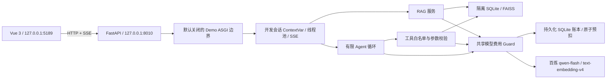
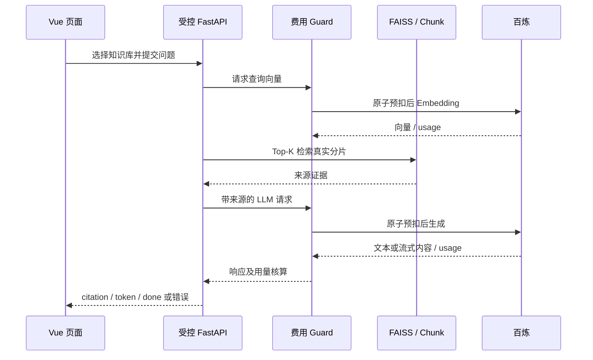
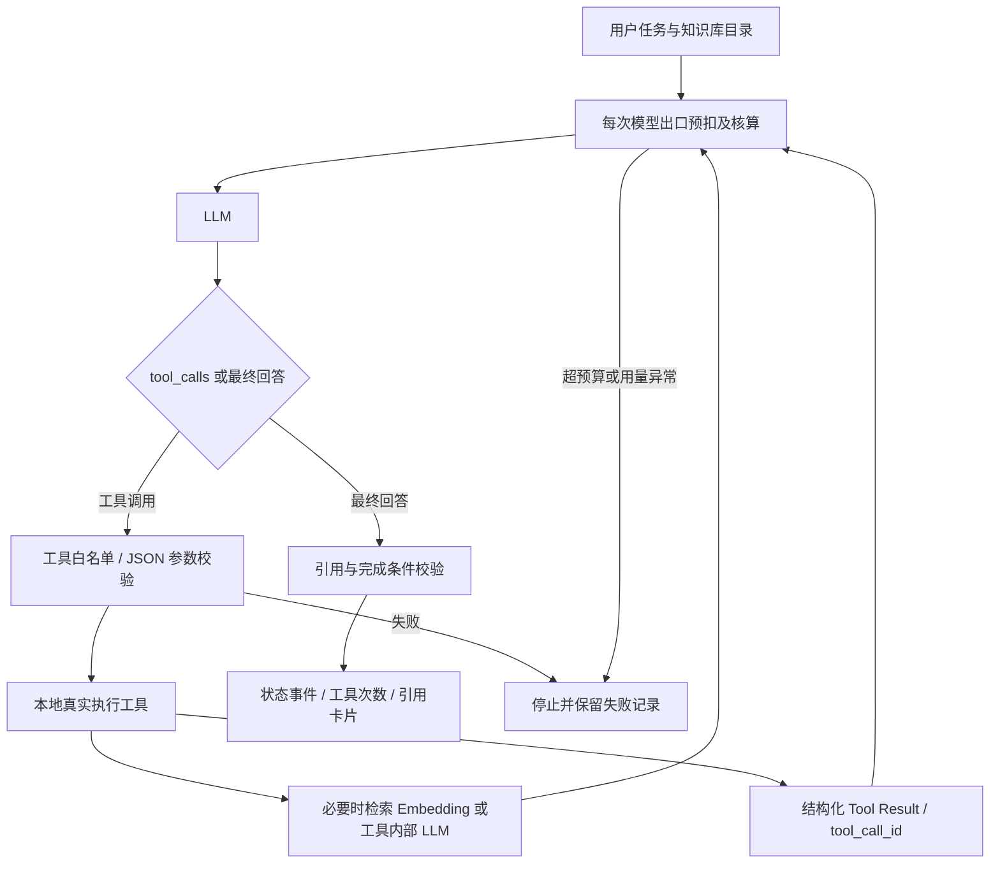

# 系统架构与调用流程

## 本机网页架构

## RAG

## Agent

calculator只做本地计算；search_documents涉及查询向量；总结、比较和出题工具内部可能再调用模型。每个出口都经过同一Guard。图示保留 Phase 8 基本调用链；当前版本在显式权限下支持资料写入、持久化会话与有界历史摘要，不能把 Phase 8 当时的网页权限限制当作当前默认功能列表。长文总结、个人模式与最新验收边界见[稳定性检查 (private operational report omitted)](release-candidate-audit.md)。
