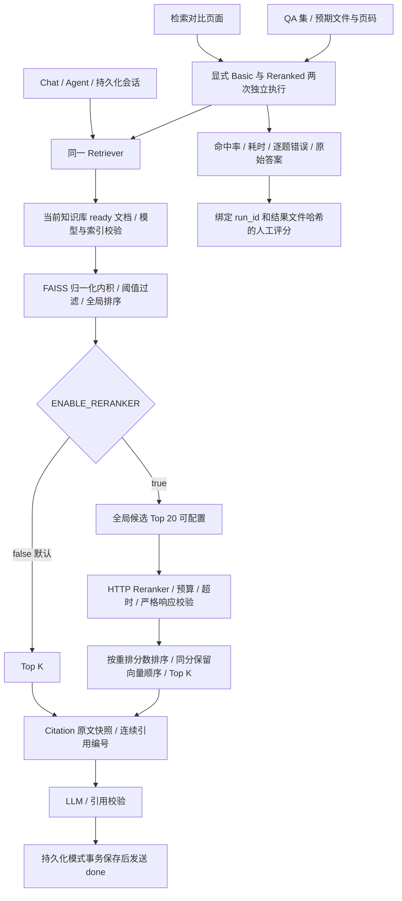

# StudyAgent Phase 1–7 架构设计

## 数据与存储

保留 KnowledgeBase 表，新增 Document/Chunk。Document 保存 UUID、知识库 ID、原文件名、格式、大小、SHA-256、状态、失败提示、分片数、模型、维度和时间。Chunk 保存 UUID、文档 ID、序号、原页码、清洗后的原文、向量 ID 和时间。

同一知识库内容 SHA-256 唯一，不同知识库允许重复。用户文件名仅用于显示；原文件内部使用 UUID 和合法后缀。每文档一个 FAISS IndexFlatIP，L2 归一化后写入；向量行号 N 对应 document_uuid:N。先写临时文件再原子替换，Python 字节 I/O 支持 Windows 中文路径。

按文档分开索引避免混合不同模型或维度。Phase 3 检索会校验模型与维度兼容性；目前不支持自动重建索引。

## 上传与解析

ASGI 中间件在 multipart 解析前限制请求体，额度为文件上限加 64 KiB 表单开销；即使无 Content-Length 也受约束。使用有界内存缓冲，文件本体另有精确字节上限。

校验空文件、扩展名、非法路径与控制字符。PyMuPDF 从字节流打开，避免损坏 PDF 在 Windows 留下文件句柄。PDF 按页抽取，DOCX 按正文段落/表格顺序读取，TXT/MD 读取文本；PDF 页码从 1 开始，其他格式为 null。

清洗换行与控制字符，保留段落/Markdown。按字符窗口切分，不跨 PDF 页面。配置限制文本总量、分片数、DOCX 解压体积。

## Embedding 与状态

EmbeddingProvider 协议定义 embed_texts。正式 CompatibleEmbeddingProvider 调用配置地址的 /embeddings，发送 model、input、encoding_format=float。分批请求，按 index 还原顺序，验证数量、维度、有限非零数值。超时、限流、错误响应均转换为可读错误，不泄漏上游内容或密钥。

模型 HTTP 使用 trust_env=False，不继承系统代理。LLM/Embedding 仅在明确配置 MODEL_HTTP_PROXY 时使用显式代理；默认直连。真实请求必须经过 Guard 和独立授权，普通 Uvicorn 不自动授予模型调用权限。配置缺失返回 503；绝不自动模拟向量。测试服务仅位于 tests 中。

processing → embedding → ready；任何阶段出错则 failed。只有 FAISS 与分片都保存成功才 ready。失败保留原文件和状态，但清除不完整索引/分片。启动时将上次中断的 processing/embedding 标记失败。

## 删除与恢复

单进程 RLock 串行化文档写入和删除，知识库删除持有同一把锁。删除先持久化 deleting 状态，再清理索引、原文件、Chunk、Document，重启可续做未完成删除。

SQLite 与文件系统并非跨存储 ACID，靠状态、原子索引替换和启动恢复处理正常中断。外部手动删除文件、磁盘损坏、多个 worker 不在保证范围，请单 worker 运行并整体备份。

## 前端

卡片可进入文档页；支持上传、进度、处理状态轮询、失败原因、分片详情和确认删除。Vue 文本插值显示原文，不执行上传内容中的脚本。删除知识库时明确告知同时删除所属文件与向量。

## 官方参考

[PyMuPDF 文本提取](https://pymupdf.readthedocs.io/en/latest/recipes-text.html) · [python-docx Document](https://python-docx.readthedocs.io/en/latest/api/document.html) · [FAISS 索引说明](https://github.com/facebookresearch/faiss/wiki/Faiss-indexes)

## Phase 3 检索与问答

Retriever 在文档服务同一把锁内对当前 knowledge_base_id 的 ready 文档建立引用快照。先验证索引模型名，生成并归一化问题向量；逐文档 FAISS 搜索，再跨文档按分数合并全局 Top-K。阈值以下分片不进入 Prompt。检查模型名、维度、索引数量、分片映射；异常明确返回错误，不混用或静默跳过损坏索引。

引用快照来自 SQLite 的文件名、页码、原文和 chunk_id，并附知识库 ID、文档 ID、排序后编号和分数。检索与引用快照完成后释放锁，LLM 生成不锁住文档管理。引用反映该请求检索时的资料；生成期间文件被删除不会修改已取得的快照。

系统消息规定仅依据本次资料回答、用 [n] 引用、无证据时固定拒答；问题和资料通过 JSON 放入用户消息，作为不可信数据。不同请求之间不传历史，不新增 Conversation/Message/Memory 表。

统一异步 LLMProvider 提供 complete/stream，使用环境配置的兼容 /chat/completions 服务，控制总超时、最大 tokens 和字符数。不记录问题、原文、回答正文、API Key 或供应商错误体。localhost/回环地址直连，其他地址遵循环境代理。

普通响应在引用校验后返回。SSE 在检索准备成功后发送 citation、token、done；模型错误/超时/无效引用发送 error 而非 done。生成片段是临时结果，done 才表示完整且编号校验通过；前端在错误时清除未完成回答。客户端取消请求会关闭上游流。

## 引用校验范围

引用元数据由后端生成，LLM 不能提交或改写来源对象。回答中的数字引用必须属于本次检索编号，并至少有一条有效编号；允许模型使用固定的资料不足句式，此时最终 citations 清空。代码围栏/行内代码中的数字下标不当作引用。

citations 是本次提供给模型的检索来源集合，不保证每个来源都在正文中被使用。编号校验不等同于对每个结论做语义蕴含验证；编号校验仍不包含额外审校模型；Phase 7 可选 Reranker 只调整候选顺序。

## Chat 前端

使用 POST fetch + ReadableStream，而非只能 GET 的 EventSource。SSE 解码支持 UTF-8 跨字节、CRLF 和多行 data；无 done 的连接中断会报错。切换知识库或离开页面取消旧请求，通过请求版本阻止迟到数据写入新页面。

markdown-it 禁用原始 HTML，DOMPurify 再清理渲染结果；不自动加载模型图片。代码块仅显示文本，不执行。原文引用用 Vue 文本插值展示。当前页面可显示多个独立问答，刷新/清空/切换知识库会丢弃展示记录，不构成 Memory 或历史会话模块。

[Markdown-it 使用说明](https://github.com/markdown-it/markdown-it/blob/master/docs/usage.md) · [DOMPurify 官方说明](https://github.com/cure53/DOMPurify)

## Phase 4 单 Agent 与工具

`AgentService` 每个请求建立独立 ToolContext、消息列表和引用簿。先读取当前库 ready 文档目录，再请求 `LLMProvider.tool_turn`。Provider 只接受完整的 assistant 工具消息或 stop 最终回答，校验工具调用 ID 唯一、名称/参数类型和长度。旧 complete/stream 不变。

执行循环将标准 assistant.tool_calls 写回对话，按顺序调用白名单工具，并追加 role=tool、tool_call_id、JSON content。工具错误会返回 ok=false 和安全错误码，允许后续修正；重复调用 ID、总工具数、轮次、上下文和总超时触发终止。所有调用尝试都计数。至少一个工具成功后才能输出最终结果；没有资料的有效检索也可用于说明资料不足。

工具 JSON Schema 禁止额外参数；knowledge_base_id 只从请求上下文传入，模型无法通过工具参数覆盖。文档读取同时限制 ID、当前库和 ready 状态，检索复用 Phase 3 Retriever。数据库工作在线程池中使用独立 Session，文档快照在现有锁内取得。总结/比较读取完整分片，超限报错；生成题目解析为严格结构并校验答案和来源。计算器解释受限 AST，不使用 eval，限制表达式长度、节点、深度、指数和数值范围。

引用按 chunk_id 在单任务内去重、固定编号，元数据仅由后端读取；失败工具回滚新增引用。非检索文档来源 score=1.0 为占位值。最终回答沿用 Phase 3 引用校验，纯计算不得伪造数字引用。编号存在不代表语义必然正确，也不保证每个来源都在最终正文使用。

Agent SSE 仅传 status/error/done，不流式发送模型规划文本、reasoning_content 或 tool-call 前的 assistant.content。最后回答保留模型最终 content，系统提示要求不展示内部思维链。前端复用安全 Markdown 和 CitationCards；AbortController 与版本号隔离停止、切库和离开页面后的迟到响应。

上述是 Phase 4 临时 Agent 的设计；Phase 5 增加持久化会话与记忆，Phase 7 增加可选重排，见下文。Mock 仅在 tests 内，正式服务无模拟回退。取消可中断异步模型请求；已开始的只读同步检索可能短暂完成，但不会再启动下一工具或向新页面显示结果。

## Phase 5–6 会话与一致性

Conversation/Message 保存用户轮次、重生成尝试、request_id、状态、答案及引用快照。单进程会话锁协调生成、删除和取消，成功事务完成后才发送 done；相同成功 request_id 重放保存结果，不重复调用模型。失败、取消、pending 不进入有效上下文；启动与再次预留时恢复遗留 pending，恢复事务独立提交。

Memory 默认保留最近 10 轮；旧完整轮次分批摘要，摘要水位和 revision 在所有批次成功后更新。偏好仅接受显式配置。Agent 和 Chat 共享同轮最新成功答案选择与快照持久化，删除原文不破坏已有引用快照。文件删除提交失败明确 rollback，保留可恢复的 deleting 状态。

## Phase 7 可选重排与评测

Basic 路径维持原 Top-K、阈值、引用及错误行为。重排扩大召回池，但不能恢复已被相似度阈值过滤的资料。重排输出必须是候选索引的完整排列；重复、缺失、越界、布尔索引、非有限分数均拒绝，HTTP 重定向不跟随，不使用静默回退。Citation.score 始终是原向量相似度，不承载重排分数。

对比接口不修改 Settings、不写 History、不注入 Memory；按 Basic 然后 Reranked 顺序独立检索，并可选择生成临时答案供评测。两次执行不是一个数据库快照，评测期间应保持语料不变；两次不同网络/缓存开销使单次耗时不能作为性能基准。请求中没有前端可控服务 URL 或密钥。

正式 Chat/Agent 启用重排时遵循后端全局开关。无候选时直接返回空结果，不调用重排或 LLM。同步检索在文档 RLock 内执行，保护原文与索引一致性；外部重排延长持锁时间，有输入预算与超时上限，不适合多 worker 或未经压测的大规模部署。浏览器停止等待不能保证中止已经运行的同步 HTTP 重排。

评测脚本与生产服务分离。分母包含失败问题；答案准确率不由关键词重合或 Mock 自评分推断，只计算明确的 0/1/2 评分，并标明已评分数量。运行记录标记 mock/real（操作者声明）、数据来源、数据集 SHA-256 和延迟范围。真实模型效果仍需独立人工标注与足够样本验证。
