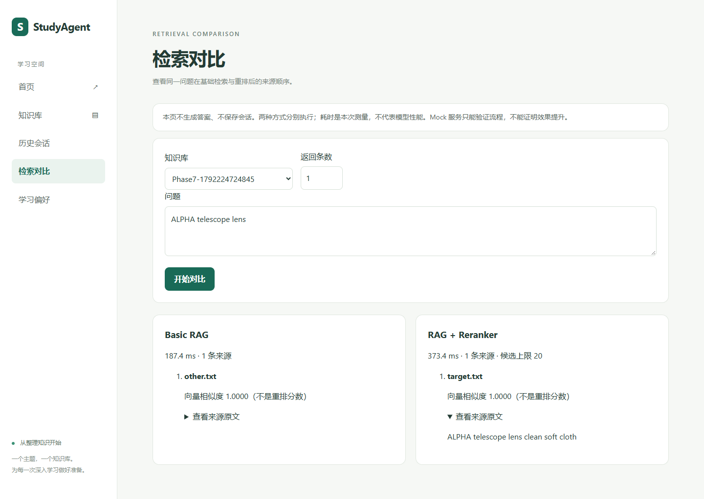

# GitHub 展示材料

## 项目简介

StudyAgent 是 Vue 3 + TypeScript + FastAPI 的本地学习资料助手。它将 PDF/DOCX/TXT/MD 转为可检索分片，基于资料回答并展示来源；提供单 Agent 工具、持久化历史、Conversation Memory、显式偏好，以及可选重排和检索对比。

## 展示要点

- SQLite 保存文档、消息和引用快照，FAISS 保存归一化向量；知识库隔离与 ready 状态过滤。
- Chat SSE 与引用编号校验，事务提交后发送 done；幂等重试、取消和中断恢复有测试。
- 单 Agent 的五个实际工具；Memory 使用完整轮次窗口和增量摘要。
- Reranker 默认关闭，开启后候选 Top 20 → 重排 → Top-K；失败明确提示，Basic 保持兼容。
- 评测记录数据来源、逐题引用与错误；人工答案评分支持 0/1/2，未评分不生成准确率。

## 展示图片

[移动端截图](screenshots/phase7-comparison-mobile.png) · [Agent 实际工具截图](screenshots/phase4-agent.png) · [历史会话](screenshots/phase5-history.png)

这些图片来自本地公开合成测试，不是生产用户数据。演示步骤见 [Demo](demo.md)，设计见 [架构图](architecture.md)。

## 可以准确陈述的验证结果

Phase 7 本地完整 pytest 409 passed，Chrome E2E 17 passed，TypeScript/Vite 构建成功。仅使用本地 Mock LLM/Embedding/词重合重排，没有真实模型效果评测或线上部署。参见 [完整报告](phase7-testing.md)。

不可把合成 Mock 命中差异写成检索提升率、模型准确率、低延迟保证或生产 SLA。没有人工评分的答案准确率必须保持未验证。

## 发布范围

代码、文档、原创合成评测资料及检查后的展示截图可作为交付内容。不要提交 `.env`、私人资料、数据库、FAISS、日志、生成 fixtures 或真实评测输出。未选择项目许可证，不擅自声明开源授权；发布者应确认代码与依赖许可后自行选择许可证。本次没有执行 GitHub 发布。
