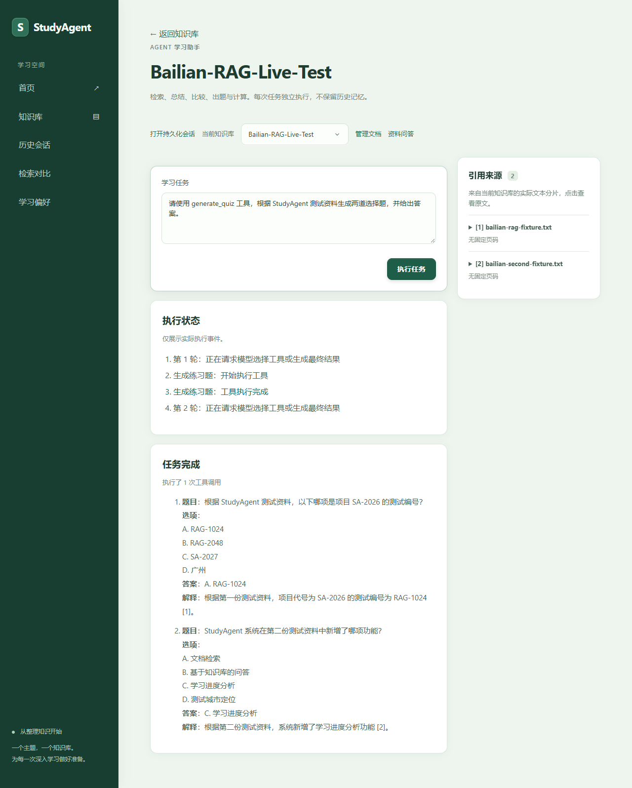

# Phase 8：受控真实模型网页 Demo 验收

日期：2026-11-10。以下截图来自真实 Vue 页面 → 本机 FastAPI → 阿里云百炼，不是 Mock 响应。仅使用项目自建的公开测试资料，未使用私人文档。

## 结果

| 页面操作 | Real结果 | 证据 |
| --- | --- | --- |
| 知识库两篇索引资料 | 通过，不重上传 | [文档页](screenshots/real-phase8/01-documents.png) |
| 普通RAG与展开来源 | 通过，SA-2026 | [回答与来源](screenshots/real-phase8/02-rag.png) |
| SSE RAG | 通过，深圳、RAG-1024，完成状态与来源 | [流式完成页](screenshots/real-phase8/03-stream.png) |
| calculator | 通过，真实工具成功事件与125结果 | [计算](screenshots/real-phase8/04-calculator.png) |
| compare_documents | 修复输出上限后通过，两文档对比及引用 | [比较](screenshots/real-phase8/05-compare.png) |
| generate_quiz | 通过，两道选择题、选项、答案及来源 | [出题](screenshots/real-phase8/06-quiz.png) |

五个工具的独立真实后端验证与本次网页验证范围不同：本次页面只演示calculator、比较、出题；检索与总结此前已有后端闭环证据，不重复宣称本次全部在网页逐一验收。

## 真实调用与必要复测

- 本次新增18次HTTP模型请求：14 LLM、4 Embedding，全部HTTP200；无底层自动重试。
- 输入13764 Token、输出2238 Token。
- 本次原价估算¥0.00545240；项目已知费用估算合计¥0.00949735。
- 项目累计43次请求；历史3条UNKNOWN继续保留，不能据已知估算宣称实际累计账单。
- 累计风险占用¥2.45023050，距离¥50还余¥47.54976950；历史保守预留未重置。本地风险限额不是阿里云账户消费硬上限。
- 本机原始逐请求账本及脱敏汇总在backend/test-results/bailian-first-live/phase8-summary.json，不提交数据库或账本。

保留的失败/复测：首次问题只说“第一份资料”，模型返回资料不足，未伪造正确答案。明确公开文件名后RAG通过。比较工具首次执行成功，但最终模型输出达到512 Token后未完整结束，业务校验失败并熔断；网页曾显示network error。离线修复为网页独立1024上限及明确SSE错误事件后，只复测比较与出题，不重复已通过操作。旧HALTED会话及全部费用保留。

## 本地模式与安全边界

默认 `web_demo_enabled=false`，普通启动不自动授权。ASGI中间件在HTTP请求完整生命周期中绑定CURRENT，覆盖线程池、Agent内部模型调用及SSE发送。仅接受127.0.0.1客户端、127.0.0.1 Host及指定Origin，拒绝转发代理头的信任。

- 后端固定127.0.0.1:8010，前端127.0.0.1:5189。
- 一个开发会话支持连续操作，共享SQLite累计预算Guard，不设置单轮金额限制。
- 单服务同一时间一个任务，每分钟最多12次操作；开发会话默认100次HTTP尝试、有效期2小时，价格确认1小时。
- 网页输出最多1024 Token，Agent最多2轮、1次工具调用；HTTP超时40秒、Agent总超时120秒。
- 同源准入与会话验证之外仍逐次经过模型出口Guard、预扣、usage核算及异常熔断。流式失败不自动重放。
- 本次只开放独立RAG/Agent，拒绝历史会话与记忆、比较评测接口及资料管理写操作；资料列表/详情可读。
- 真实模型配置只读自后端.env，未写入前端变量；日志不记录Authorization或请求正文。

启动入口为 `backend/tests/start_web_demo.py --enable-authorized-web-demo`。此入口使用唯一grant防止误重复执行，本次grant已消费。修复轮次通过显式 `--verified-output-fix` 追加且也已结束；重复执行不会清账或自动恢复额度。后续演示应沿现有开发会话API创建新的明确会话/授权标识，不能删除seal、恢复HALTED或复用已结束轮次。不能直接把这两个已消费的验收命令当作永久启动命令。

真实浏览器用例位于frontend/tests/real-demo.spec.ts，默认跳过，只有STUDYAGENT_REAL_DEMO=AUTHORIZED才可能运行；无测试自动重试。VITE_API_BASE_URL必须设置为http://127.0.0.1:8010，独立5189端口。不要把网页模式部署到公网。

## Offline与构建证据

- 后端全量离线回归566项通过（SSE补充测试加入前）；修复后专项34项通过，SSE与上下文最终4项通过。
- 前端vue-tsc与Vite构建通过，Mock浏览器契约5项通过。
- Real浏览器：首次中止后进行限定复测；RAG/SSE/calculator通过，输出修复后比较/出题测试通过。不能把失败尝试从费用记录中排除。
- Mock用例使用临时数据库和Mock HTTP，浏览器离线用例拦截所有API。Mock截图与本目录real-phase8截图分开。

## 已知限制与发布准备

短公开资料的成功不等同于大规模质量评测。首次回答暴露文档指代歧义；还需评估复杂多工具任务、低相关性/无答案、取消、移动端、断网与大文档质量。异常处理有离线覆盖，真实错误注入未额外付费触发。本次不开放持久化记忆成本路径。

源代码、Mermaid架构图和公开截图可进入GitHub最终审阅。发布前检查.env、数据库、FAISS、上传目录、账本、seal与测试产物被忽略且未跟踪；不上传本机运行数据。尚未提交、未git push，等待人工发布审阅。本次Demo进程已关闭，修复会话已标记COMPLETE；不是留在后台持续消费。
