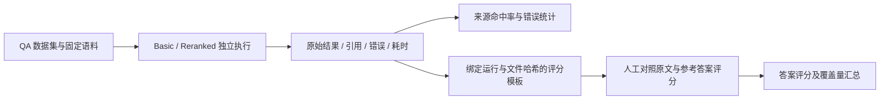

# StudyAgent · RAG Evaluation

**可复现的检索对比与人工答案评价流程**

[返回项目主页](../README.md) · [系统架构](../docs/architecture.md) · [对比接口](../docs/api.md) · [历史验证报告](../docs/phase7-testing.md)

---

## 模块定位

本模块独立于生产服务，用于比较 **Basic RAG** 与 **RAG + Reranker** 的来源命中情况，记录每题的引用、答案、错误和耗时，并通过显式人工评分评估回答质量。

评测强调三个可核查的问题：检索是否找到预期来源、请求是否成功完成、答案是否经过实际评审。测试通过、来源命中和语义正确性分别记录，不互相替代。

> 当前公开数据包含 6 篇项目原创英文合成笔记和 6 个问题，仅用于工程流程验证，不是外部模型基准。现有 Mock 记录不代表真实模型效果。

## 评测能力

- **双模式对比**：同一问题依次执行 Basic 与 Reranked，保留分支结果及错误。
- **来源匹配**：按预期文件名及页码判断 Top-K 命中，失败问题仍计入分母。
- **可选答案生成**：默认只评测检索；显式开启后调用当前后端 LLM。
- **人工评分**：按 0 / 1 / 2 记录错误、部分正确、正确，并报告评分覆盖量。
- **结果绑定**：评分文件绑定 `run_id` 与原始结果文件 SHA-256，避免误用其他实验的评分。
- **实验追溯**：记录数据集哈希、环境声明、服务备注、逐题来源、参数与时间。

## 目录结构

```text
evaluation/
├── corpus/                  # 六篇公开合成英文资料
├── qa_dataset.json          # 问题、预期来源与参考答案
├── evaluate_retrieval.py    # 检索 / 可选答案采集 CLI
├── evaluate_answer.py       # 人工评分模板与汇总 CLI
├── metrics.py              # 数据校验、命中率与评分计算
├── results/                 # 本地输出，默认被 Git 忽略
└── README.md
```

## 工作流程



## 运行环境

- 已按 [项目部署步骤](../README.md#部署步骤) 安装 Python 后端依赖。
- 后端可访问，默认地址为 `http://127.0.0.1:8000`。
- 双模式对比需要配置 Reranker；即使 `ENABLE_RERANKER=false`，对比接口仍显式执行重排分支。
- Mock 演示需先按 [本地联调说明](../README.md#mock-本地联调当前使用方式) 启动测试服务与隔离后端。
- 以下命令均在项目根目录执行，使用 Windows PowerShell。

## 快速开始

### 1. 采集检索结果

使用公开合成语料创建临时知识库并评测：

```powershell
backend\.venv\Scripts\python.exe -m evaluation.evaluate_retrieval `
  --seed-corpus evaluation/corpus `
  --environment mock `
  --provider-note "Local TEST-ONLY-RAG / TEST-ONLY-AGENT / TEST-ONLY-LEXICAL" `
  --top-k 1 `
  --output evaluation/results/mock-retrieval.json
```

`--seed-corpus` 只创建并上传到本次新知识库，在 `finally` 中尝试删除该库，不操作已有库。若后端不可达或清理失败，应检查本次临时资源。建议仅在本地 Mock 演示中使用该模式，以控制上传与调用开销。

### 2. 可选：同时生成答案

```powershell
backend\.venv\Scripts\python.exe -m evaluation.evaluate_retrieval `
  --seed-corpus evaluation/corpus `
  --environment mock `
  --provider-note "Local deterministic protocol fixtures" `
  --top-k 1 `
  --include-answers `
  --output evaluation/results/mock-answers.json
```

`--include-answers` 会实际调用当前后端配置的 LLM。若只研究检索命中率，应省略该参数，避免答案生成失败影响完整分支的成功统计。

### 3. 生成人工评分模板

```powershell
backend\.venv\Scripts\python.exe -m evaluation.evaluate_answer `
  --results evaluation/results/mock-answers.json `
  --output evaluation/results/review.json
```

填写 `reviewer`，对照原文与参考答案逐条打分；删除尚未评审的条目。模板中的 `null` 是待填写状态，不是合法评分。

```json
{
  "run_id": "<保留模板生成的运行 ID>",
  "results_sha256": "<保留模板生成的结果文件哈希>",
  "reviewer": "reviewer-name",
  "scores": [
    { "id": "<数据集中实际的问题 ID>", "mode": "basic", "score": 1 },
    { "id": "<数据集中实际的问题 ID>", "mode": "reranked", "score": 2 }
  ]
}
```

### 4. 汇总评分

```powershell
backend\.venv\Scripts\python.exe -m evaluation.evaluate_answer `
  --results evaluation/results/mock-answers.json `
  --grades evaluation/results/review.json `
  --output evaluation/results/answer-summary.json
```

重复评分、非法分数、未知问题、失败或缺失答案均被拒绝。修改原始结果文件后，已有评分文件不再匹配，需重新生成并评审。

## 评测已有知识库

使用自有数据集与已就绪知识库时，将临时语料选项替换为 `--kb-id`：

```powershell
backend\.venv\Scripts\python.exe -m evaluation.evaluate_retrieval `
  --base-url http://127.0.0.1:8000 `
  --kb-id 1 `
  --dataset evaluation/qa_dataset.json `
  --environment real `
  --provider-note "Actual model names and service versions" `
  --top-k 5 `
  --include-answers `
  --output evaluation/results/real-run.json
```

请将 `1` 替换为实际知识库 ID，并提供与该库内容匹配的数据集。此模式不上传或删除知识库，评测期间应保持语料不变。

`--environment` 是操作者声明，不会自动探测服务类型；混合 Mock 与真实服务时标记为 `mock`，并在备注中说明。`provider-note` 只写模型或服务标识，不填写密钥。

## 数据集格式

```json
{
  "version": 1,
  "source": "资料来源、版本与使用许可说明",
  "cases": [
    {
      "id": "case-001",
      "question": "需要评测的问题",
      "expected_document": "source.txt",
      "expected_page": null,
      "reference_answer": "人工编写的参考答案"
    }
  ]
}
```

- `id` 必须唯一；`expected_document` 对应上传后的实际文件名。
- PDF 页码从 1 开始；TXT / MD 等无固定页码资料使用 `null`，命中时也要求来源页码为 `null`。
- 当前每题指定一个预期文件与页码，衡量是否命中预期来源，不衡量多证据覆盖程度。
- 自建数据集应覆盖改写、跨页、无答案、多来源和难负例；当前命中模型若不足以表达标注需求，应先扩展数据结构与指标。

## 指标定义

| 指标 | 计算方式 | 解读边界 |
| --- | --- | --- |
| Retrieval Hit Rate@K | 命中预期文件与页码且分支成功的问题数 / 全部问题数 | 失败计入分母；不等同于证据完整或答案正确 |
| Answer Accuracy | 人工评分之和 /（2 × 已评分答案数） | 同时报告 `scored`、`total`、`complete`；是归一化人工评分 |
| Mean Response Time | 每分支耗时的算术均值，包含失败尝试 | 默认含检索与重排，开启答案后再含生成 |
| Errors | 分支失败次数与逐题错误码 | 用于区分效果不足与工程失败 |

没有人工评分时，`answer_accuracy=null`、`scored=0`、`complete=false`。部分评分只反映已评审子集，不能当作全量准确率；项目不使用关键词匹配或 Mock 自评分推断答案正确性。

正常分支耗时来自服务端 `perf_counter` 测量；HTTP 请求整体失败时记录客户端失败等待时间，并标记 `EVALUATION_REQUEST_FAILED`。Basic 与 Reranked 顺序执行，不是同一个不可变数据快照；当前没有预热、随机化或置信区间，均值不构成生产性能基准。

## 公开实验记录

以下为 **2026-10-17 历史 Mock 实验**，原始输出见 [公开记录](../docs/phase7-mock-results.json)，本次文档整理未重新采集。

| 指标 | Basic | Reranked |
| --- | ---: | ---: |
| 样本数 | 6 | 6 |
| Hit@1 | 2/6 | 6/6 |
| 分支错误 | 0 | 0 |
| 平均耗时，含 Mock 生成 | 215.49 ms | 385.87 ms |
| 人工已评分答案 | 0/6 | 0/6 |
| Answer Accuracy | null | null |

本次使用固定向量、英文词重合重排和脚本式答案。上述结果仅证明评测框架能够记录排序差异、错误与耗时，不能据此推导真实模型的检索提升或答案质量。UUID 同分排序、系统负载和请求时序均可能影响复现数值。

## 验证与扩展方向

评测逻辑测试可从 `backend` 目录执行：

```powershell
.\.venv\Scripts\python.exe -m pytest tests/test_phase7_evaluation.py tests/test_phase7_reranker.py -q
```

后续重点包括真实中文资料标注、供应商协议验证、人工盲评、正确拒答评价，以及固定版本与语料条件下的重复实验。性能实验需补充延迟分布、并发、成本与资源消耗，不以单次 Mock 均值替代。

`results/` 默认被 Git 忽略，输出可能包含完整原文与答案。公开实验时应单独检查来源授权、隐私与结果内容，仅将确认可公开的资料纳入版本管理。
